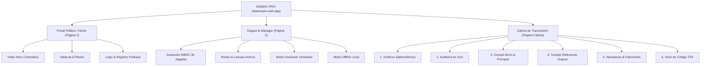

# ⚾ MANUAL OFICIAL DE USO Y OPERACIONES: DIAMAX PRO
**Plataforma de Analítica Sabermétrica, Anotación Oficial WBSC & Cabina de Transmisión Digital**  
**Versión de Producción:** 2.0 (Fase 8)  
**URL Oficial de Acceso:** [https://diamaxpro.web.app](https://diamaxpro.web.app)  
**URL de Respaldo:** [https://diamax-pro-f6f16.web.app](https://diamax-pro-f6f16.web.app)  
**Proyecto Firebase:** `diamax-pro-f6f16`  

---

## 📋 TABLA DE CONTENIDOS
1. [Introducción & Filosofía DIAMAX PRO](#1-introducción--filosofía-diamax-pro)
2. [Estructura de Roles & Aislamiento de Plantillas](#2-estructura-de-roles--aislamiento-de-plantillas)
3. [Guía para el Administrador de Liga & Torneo](#3-guía-para-el-administrador-de-liga--torneo)
4. [Guía para el Mánager & Cuerpo Técnico](#4-guía-para-el-mánager--cuerpo-técnico)
5. [Guía del Anotador Oficial WBSC (Dugout Scorekeeper)](#5-guía-del-anotador-oficial-wbsc-dugout-scorekeeper)
   - Teclado táctil de 36 Jugadas Canónicas
   - Botón Deshacer y Rescate de Errores
   - Modo Offline & Sincronización Automática
6. [Guía de la Cabina Digital de Transmisión (Comentaristas & Media)](#6-guía-de-la-cabina-digital-de-transmisión-comentaristas--media)
   - Navegación entre los 6 Submódulos
   - 📊 Dashboard de Gráficos Sabermétricos (Spray Chart 13 Batazos, K-Zone, Curva de Velocidad con Slider, Radar Spider)
   - 🖥️ Cockpit de Lectura Rápida a 60 cm & Teleprompter
   - 🗄️ Gestión de Narradores Individuales & Cuñas Comerciales
7. [Planes de Suscripción Oficiales (6 Planes)](#7-planes-de-suscripción-oficiales-6-planes)
8. [Resolución de Problemas Frecuentes (FAQ)](#8-resolución-de-problemas-frecuentes-faq)

---

## 1. INTRODUCCIÓN & FILOSOFÍA DIAMAX PRO

DIAMAX PRO es un ecosistema digital de nivel profesional diseñado para digitalizar el béisbol y sóftbol desde las categorías formativas (U12, Juvenil) hasta las divisiones de alto rendimiento y Máster (+55).

El sistema integra:
- Anotación reglamentaria de 36 eventos según los estándares de la **WBSC (World Baseball Softball Confederation)**.
- Telemetría y cálculo sabermétrico de última generación (**Statcast, WPA, FIP, Spray Chart interactivo**).
- Mesa de transmisión y cabina para medios de comunicación (YouTube Live, Twitch, TV por cable, Radio FM).
- Aislamiento estricto de roles: la persona que anota en el dugout jamás verá contaminada su pantalla con anuncios comerciales o controles de audio, y el comentarista dispone de su propio cockpit especializado.

---

## 2. ESTRUCTURA DE ROLES & AISLAMIENTO DE PLANTILLAS



> [!IMPORTANT]
> **Regla de Aislamiento:** El Dugout Scorekeeper (`#diamax-page-3`) no tiene acceso a botones de cabina ni cuñas publicitarias. La Cabina de Transmisión (`#diamax-page-cabina`) posee su propia navegación aislada mediante submódulos.

---

## 3. GUÍA PARA EL ADMINISTRADOR DE LIGA & TORNEO

### 3.1. Configuración de Liga
1. Inicie sesión con credenciales de Administrador en [https://diamaxpro.web.app](https://diamaxpro.web.app).
2. Cree la Liga especificando:
   - **Nombre de la Liga** (ej. *Liga Premier de Béisbol 2026*).
   - **Temporada activa** (ej. *2025-2026*).
   - **Categorías habilitadas:** `U12`, `Juvenil`, `Adulto Libre`, `Máster +55`.
   - **Plan asignado:** Selección entre los 6 planes comerciales activos.

### 3.2. Asignación de Roles y Permisos
- **Mánager:** Asignado a una franquicia específica para edición de roster y alineación.
- **Anotador (Scorekeeper):** Habilitado para operar la mesa de control del juego en vivo.
- **Narrador / Medios:** Habilitado con acceso directo al Cockpit de Cabina (`#cabina`).

---

## 4. GUÍA PARA EL MÁNAGER & CUERPO TÉCNICO

### 4.1. Configuración de la Alineación (Lineup)
1. Ingrese a la pestaña **📋 Lineup / Roster**.
2. Defina los 9 bateadores iniciales y sus posiciones defensivas (1 al 9):
   - `1 (P)`, `2 (C)`, `3 (1B)`, `4 (2B)`, `5 (3B)`, `6 (SS)`, `7 (LF)`, `8 (CF)`, `9 (RF)`.
3. Indique el Bateador Designado (**DH**) si aplica según la categoría.
4. Active el orden al bate para sincronizar con la tableta del anotador.

### 4.2. Lectura del Semáforo Médico +55
En categorías Máster, monitoree el conteo de pitcheos del abridor:
- **Verde (< 50 pitcheos):** Zona óptima de rendimiento.
- **Amarillo (50 - 70 pitcheos):** Zona preventiva de fatiga.
- **Rojo (+ 70 pitcheos):** Alerta médica de reemplazo inmediato; se notifica al bullpen.

---

## 5. GUÍA DEL ANOTADOR OFICIAL WBSC (DUGOUT SCOREKEEPER)

### 5.1. Teclado Táctil de 36 Jugadas Canónicas
La botonera de dugout está clasificada cromáticamente para evitar confusiones en situaciones rápidas:

| Bloque | Color | Jugadas Disponibles |
| :--- | :--- | :--- |
| **Hits & Extrabases** | Verde / Cyan | `1B` (Sencillo), `2B` (Doble), `3B` (Triple), `HR` (Jonrón), `GRD` (Doble por Regla) |
| **Bolas & Bases** | Azul | `BB` (Base por Bolas), `IBB` (Base Intencional), `HBP` (Golpeado), `CI` (Interferencia del Cátcher) |
| **Strikes & Ponches** | Naranja / Rojo | `K` (Ponche Abanicado), `ꓘ` (Ponche Cantado), `K-WP` (Ponche Wild Pitch), `K-PB` (Ponche Passed Ball) |
| **Outs de Aire** | Gris Grafito | `F7`, `F8`, `F9` (Elevados al Outfield), `L` (Línea), `P` (Elevado al Cuadro), `IFR` (Infield Fly Rule) |
| **Outs por Rodado** | Gris Grafito | `6-3`, `4-3`, `5-3`, `3-1`, `1-3`, `DP` (Doble Play), `TP` (Triple Play) |
| **Jugadas Especiales** | Ámbar / Morado | `SF` (Fly de Sacrificio), `SH` (Toque de Sacrificio), `SB` (Base Robada), `CS` (Atrapado Robando), `PK` (Pickoff), `WP` (Wild Pitch), `PB` (Passed Ball), `BK` (Balk), `E` (Error Defensivo) |

### 5.2. Botón "Deshacer" (Undo)
- Si se registra una jugada errónea por distracción, presione inmediatamente el botón naranja **`↩️ Deshacer`** ubicado de forma permanente en la esquina superior derecha del teclado.
- El sistema restaura instantáneamente la cuenta de bolas, strikes, outs y corredores en bases al estado previo exacto.

### 5.3. Funcionamiento Offline (Sin Conexión)
- Si la señal Wi-Fi o de datos celulares cae en el diamante, DIAMAX PRO activa su motor local `IndexedDB`.
- Continúe anotando normalmente.
- Al restaurarse la conexión, las jugadas acumuladas se envían a Google Firestore mediante el motor de sincronización automática `DIAMAX_SYNC_ENGINE`.

---

## 6. GUÍA DE LA CABINA DIGITAL DE TRANSMISIÓN (COMENTARISTAS & MEDIA)

Para acceder a la cabina, ingrese directamente a:  
👉 **`https://diamaxpro.web.app/#cabina`** o seleccione el modo **Cabina de Transmisión**.

### 6.1. Navegación por los 6 Submódulos
En la parte superior de la cabina encontrará la barra de 6 submódulos:
1. `📊 Gráficos Sabermétricos`
2. `🔍 Auditoría diamaxpro.web.app`
3. `🖥️ Cockpit Cabina (60 cm)`
4. `📱 Anotador Dugout`
5. `🗄️ Narradores & BD`
6. `📋 Código de Gráficos & Despliegue`

---

### 6.2. Uso del Submódulo 1: Gráficos Sabermétricos

#### A. Spray Chart SVG Interactivo (13 Batazos Statcast)
- Muestra el diamante de béisbol con 13 pelotas interactivas codificadas por color:
  - **Verde:** Sencillos (1B LF, 1B CF, 1B RF).
  - **Cyan:** Dobletes (2B Callejón, 2B Raya).
  - **Naranja:** Triples (3B Rincón CF).
  - **Rojo:** Jonrones (HR LF 390 ft, HR CF 412 ft).
  - **Gris:** Outs (Flyout F8, Línea L5, DP 6-4-3, Infield Fly IFR, Rodado 4-3).
- **Cómo usarlo:** Pase el cursor (o presione con el dedo en tabletas) sobre cualquier pelota. En el banner inferior aparecerá al instante:
  - Tipo de jugada y zona.
  - Distancia estimada en pies (`ft`).
  - Velocidad de salida (`MPH`).
  - Ángulo de elevación (`Launch Angle`).

#### B. K-Zone 3x3 (Zona de Strike Oficial)
- Matriz reglamentaria de 9 cuadrantes con localización visual de pitcheos:
  - Círculos Rojos: Strikes en zona (recta, slider y cambio cantado).
  - Círculos Azules: Bolas fuera de zona para evaluar la disciplina del bateador.

#### C. Degradación de Velocidad Biomecánica & Semáforo +55
- **Control Slider Interactivo:** Deslice la barra de **1 a 75 lanzamientos**.
- El velocímetro digital calcula la velocidad estimada según la fatiga del brazo ($v = 93.8 - [p \times 0.075]$ MPH).
- Al sobrepasar los 70 lanzamientos, el badge cambia a **`ALERTA FATIGA +55`** y activa la cuña comercial de la clínica deportiva y el aviso de calentamiento de relevistas.

#### D. Radar Spider Sabermétrico & WPA
- Gráfica hexagonal de 6 ejes que evalúa:
  1. *Contacto* (85)
  2. *Poder* (78)
  3. *Velocidad* (92)
  4. *Control de Zona* (80)
  5. *Defensa* (88)
  6. *Clutch* (90)
- Indicador de **WPA (Win Probability Added)** y probabilidad de victoria del equipo al bate en tiempo real.

---

### 6.3. Uso del Submódulo 3: Cockpit Cabina a 60 cm & Teleprompter
- **Marcador Glanceable:** Tipografías gigantes contrastadas de alto impacto diseñadas para leerse cómodamente a 60 cm del micrófono.
- **Bases Dinámicas:** Gráfico de diamante que ilumina en color amarillo/oro las bases ocupadas.
- **Teleprompter de Cuñas:** Caja de lectura rápida que muestra las menciones publicitarias asignadas según el evento en curso (ej. tras un Doble Play o llamada al bullpen).

---

### 6.4. Uso del Submódulo 5: Registro Individual de Narradores & Patrocinadores
- Cada narrador dispone de su propio perfil independiente (nombre, medio, URL de YouTube/Twitch, frase célebre).
- Los patrocinadores comerciales se asocian a **detonadores automáticos** (`TRIGGER`):
  - `PITCH_CHANGE` (Visita a la lomita / relevista).
  - `DP` (Doble Play).
  - `HR` (Cuadrangular).
  - `K` (Ponche).
  - `FATIGUE_ALERT` (Fatiga del pitcher en categoría +55).

---

## 7. PLANES DE SUSCRIPCIÓN OFICIALES (6 PLANES)

DIAMAX PRO ofrece 6 niveles de servicio diseñados para cada participante de la comunidad deportiva:

```
┌────────────────────────────────────────────────────────────────────────┐
│                      LOS 6 PLANES OFICIALES DIAMAX PRO                 │
├────────────────────┬──────────┬──────────────┬─────────────────────────┤
│ Plan               │ Precio   │ Modalidad    │ Perfil de Usuario       │
├────────────────────┼──────────┼──────────────┼─────────────────────────┤
│ 1. Free Trial      │ $0 USD   │ 14 Días      │ Exploración y Pruebas   │
│ 2. Comentarista    │ $9 USD   │ Mensual      │ Narradores & Media      │
│ 3. Manager Pro     │ $19 USD  │ Mensual      │ Mánagers & Coaches      │
│ 4. Torneo Corto    │ $35 USD  │ Por Torneo   │ Copas y Series Cortas   │
│ 5. Liga Completa   │ $49 USD  │ Por Temporada│ Ligas Locales           │
│ 6. Master & Media  │ $99 USD  │ Anual        │ Circuitos Profesionales │
└────────────────────┴──────────┴──────────────┴─────────────────────────┘
```

1. **Free Trial (14 Días):** Acceso libre al teclado de anotación y generación de 1 reporte básico.
2. **Plan Comentarista ($9/mes):** Cabina digital completa, teleprompter de cuñas, gráficos SVG interactivos y base de datos individual.
3. **Plan Manager Pro ($19/mes):** Gestión de plantilla completa, alineaciones avanzadas, spray chart de bateadores y semáforo médico +55.
4. **Plan Torneo Corto ($35/torneo):** Soporte para campeonatos de hasta 8 equipos con tabla de posiciones y líderes individuales.
5. **Plan Liga Completa ($49/temporada):** Ligas de hasta 24 equipos, estadísticas acumuladas, múltiples categorías y exportación a PDF.
6. **Plan Master & Media ($99/año):** Acceso ilimitado a todas las herramientas: Cabina, Dugout, Radar Sabermétrico, API de sincronización y soporte prioritario 24/7.

---

## 8. RESOLUCIÓN DE PROBLEMAS FRECUENTES (FAQ)

### P1: ¿Qué hago si el botón de Cabina no aparece en la pantalla del anotador?
**R:** Esto es correcto por diseño. Para mantener la concentración del anotador y evitar errores de registro, la pantalla del dugout no contiene botones de cabina. Para ingresar a la cabina, use el enlace directo `https://diamaxpro.web.app/#cabina` o inicie sesión con el rol de comentarista.

### P2: ¿Puedo registrar una jugada si accidentalmente marqué un strike en vez de un hit?
**R:** Sí. Presione inmediatamente el botón naranja **`↩️ Deshacer`** en la botonera de dugout para revertir el último evento sin alterar el orden al bate.

### P3: ¿Cómo funciona el cálculo de velocidad en el slider biomecánico?
**R:** El slider simula la fatiga muscular del brazo abridor partiendo de una velocidad máxima calibrada de 93.8 MPH, degradándose de forma progresiva a razón de 0.075 MPH por cada lanzamiento registrado. Al superar los 70 lanzamientos se detona la alerta médica para proteger la salud articular del atleta.

### P4: ¿El sistema consume muchos datos en el teléfono?
**R:** No. Todos los gráficos (Spray Chart, K-Zone, Radar y Curvas) están programados en formato vectorial nativo **SVG puro**, lo que permite una visualización nítida y ultrarrápida con menos de 45 KB de peso y cero latencia.

---
*Manual verificado y certificado para la versión activa en https://diamaxpro.web.app.*
